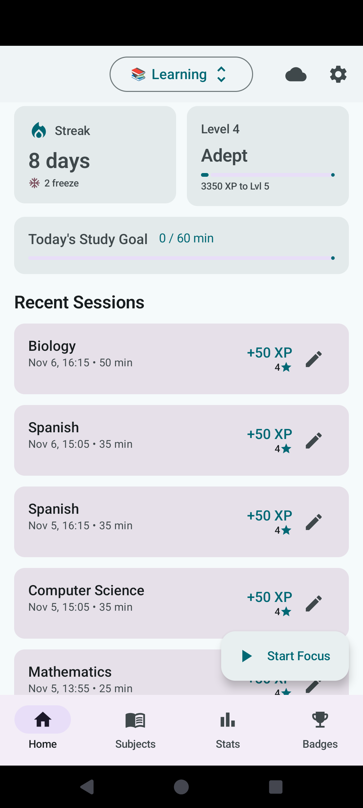
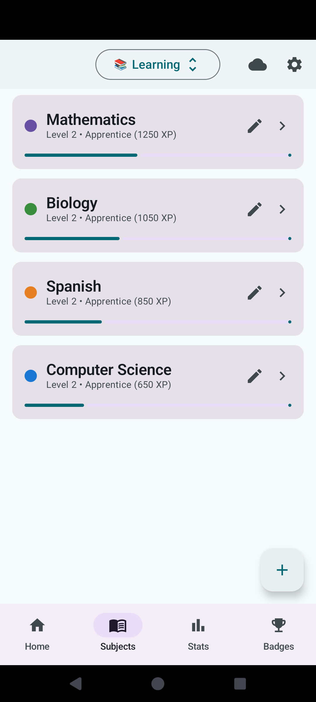
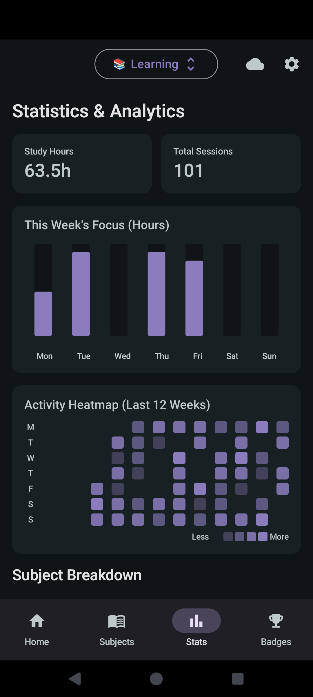
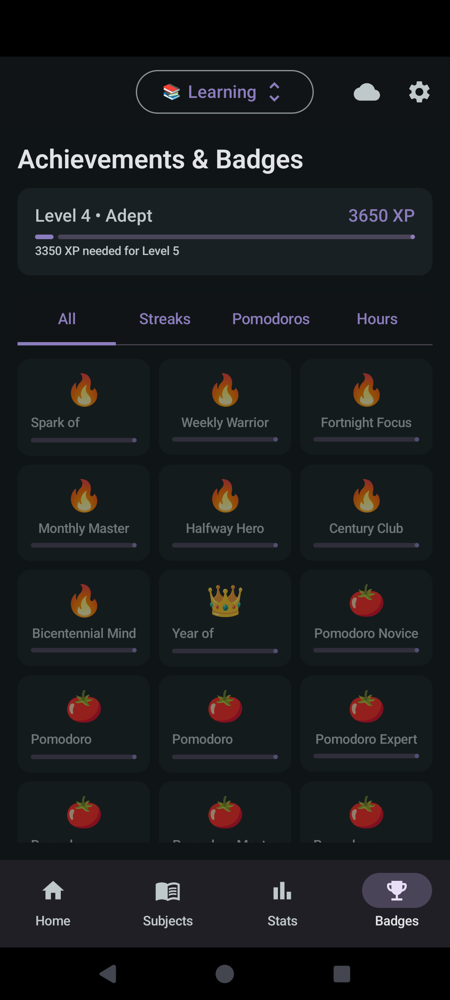

<h1 align="center">StudyHabit</h1>

<p align="center"><strong>Make time to focus. See your progress.</strong><br>Study sessions, subjects, and achievements in one place.</p>

<p align="center">
  <a href="#get-started">Get started</a> ·
  <a href="#a-look-inside">Screenshots</a> ·
  <a href="#self-host-the-dashboard">Deployment</a> ·
  <a href="docs/releases/README.md">Releases</a>
</p>

StudyHabit helps you organize subjects and learning materials, run focused study sessions, and track your progress with streaks, XP, and achievements. The current Android app is built with Kotlin and Jetpack Compose. A React web dashboard and Express API provide the optional server components; older Flutter sources, including the historical Windows desktop target, are retained under `archive/flutter-legacy/`.

**Android 8.0+ · Material 3 · Local study tracking · Light and dark themes**

## What you can do

| | Features |
|---|---|
| **Focus on a session** | Use a configurable Pomodoro timer and review your study sessions. |
| **Organize your learning** | Group subjects, topics, chapters, and source material. |
| **Build a habit** | Track streaks, earn XP, and unlock achievements. |
| **See your progress** | Explore weekly focus charts, subject breakdowns, and activity history. |
| **Keep your data** | Use export/import and optional synchronization; check the app settings for available sync options. |

## A look inside

Existing Android captures with fictional study data, shown in light and dark themes.

<table>
  <tr>
    <td align="center" width="33%"><br><strong>Your day</strong></td>
    <td align="center" width="33%"><br><strong>Your subjects</strong></td>
    <td align="center" width="33%"><br><strong>Your progress</strong></td>
  </tr>
</table>

<details>
<summary>More screenshots: achievements</summary>



</details>

## Get started

Install an Android build from the [project releases](https://github.com/thies2005/studyhabit/releases), or build the native app locally. Create your subjects, choose a focus interval, and complete a session to start tracking progress.

### Build the Android app

Use JDK 17 and Android SDK 35. From `android/`:

```sh
./gradlew assembleDebug
./gradlew testDebugUnitTest lintDebug
```

The debug APK is written to `app/build/outputs/apk/debug/`. Release signing is explicitly enabled with `-Pstudyhabit.release.signing.enabled=true` and requires the existing private `android/app/key.properties`. See [release channels and signing](docs/releases/README.md).

## Project layout

| Path | Purpose |
|---|---|
| `android/` | Current native Android app: Kotlin, Compose, Room, and local services |
| `web/` | React and Vite dashboard |
| `backend/` | Express, Prisma, and PostgreSQL API |
| `archive/` | Historical Flutter implementation |
| `docs/` | Release policy and project documentation |

## Self-host the dashboard

### Web dashboard development

```bash
cd web

# Install dependencies
npm install

# Start dev server
npm run dev
# Open http://localhost:5173
```

### Backend API development

```bash
cd backend

# Install dependencies
npm install

# Set up environment
cp ../.env.example .env
# Edit .env and set DATABASE_URL for your local Postgres instance

# Run Prisma migrations
npx prisma migrate dev

# Start dev server
npm run dev
# API runs on http://localhost:3001
```

## Deploy the server

### Docker Compose

```bash
# Copy env template and configure
cp .env.example .env
# Edit .env with strong passwords and JWT secrets

# Build and start all services
docker compose up -d --build

# Services:
#   - Web dashboard:  http://localhost:3000
#   - API:             http://localhost:3001
#   - PostgreSQL:      db:5432 (Compose network only)
```

### Coolify

Deploy the repository’s `docker-compose.yml` as a Compose stack. Set `DB_PASSWORD`, `JWT_SECRET`, `CORS_ORIGIN`, and the dashboard’s `API_URL` for your environment before building. Configure HTTPS through your reverse proxy; keep the database private.

## XP and achievements

| Action | XP |
|--------|-----|
| Complete 1 Pomodoro (25 min) | +50 |
| Complete long session (50+ min) | +120 |
| Rate session confidence | +10 |
| Add a source/document | +5 |
| Advance skill label upward | +100 |
| Hit 7/30/100-day streak | +500 |

**Level Thresholds:** Novice (0) → Apprentice (500) → Scholar (1500) → Adept (3500) → Expert (7000) → Master → Grandmaster

## API reference

Base URL: `/api/v1`

| Method | Endpoint | Description |
|--------|----------|-------------|
| POST | `/auth/register` | Create account |
| POST | `/auth/login` | Login (returns JWT) |
| POST | `/auth/refresh` | Refresh access token |
| GET | `/projects` | List user projects |
| POST | `/projects` | Create project |
| PATCH | `/projects/:id` | Update project |
| DELETE | `/projects/:id` | Delete project |
| GET | `/projects/:id/subjects` | List subjects |
| GET/POST/PATCH/DELETE | `/subjects/:id` | Subject CRUD |
| GET/POST/PATCH/DELETE | `/sessions/:id` | Session CRUD |
| GET/POST/PATCH/DELETE | `/sources/:id` | Source CRUD |
| GET | `/stats/overview` | Stats overview |
| GET | `/stats/heatmap?days=84` | Activity heatmap data |
| GET | `/stats/subjects?days=30` | Subject breakdown |
| GET | `/achievements` | List achievements |
| POST | `/achievements/:key/unlock` | Unlock achievement |

## Local data and sync

The current Android app stores study data locally using Room. Server and folder synchronization options are available in the app; the archived Flutter implementation has its own historical sync behavior.

## License

StudyHabit is licensed under **GPL-3.0-or-later**. See [LICENSE](LICENSE) and the [release policy](docs/releases/README.md). Existing third-party notices and licenses still apply.
